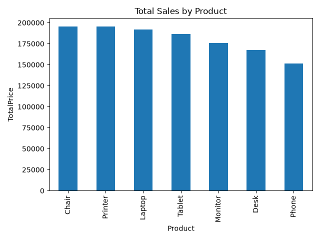
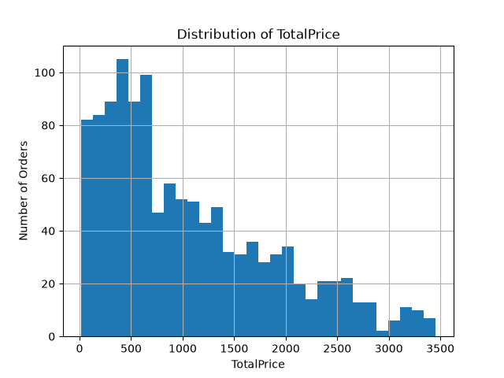
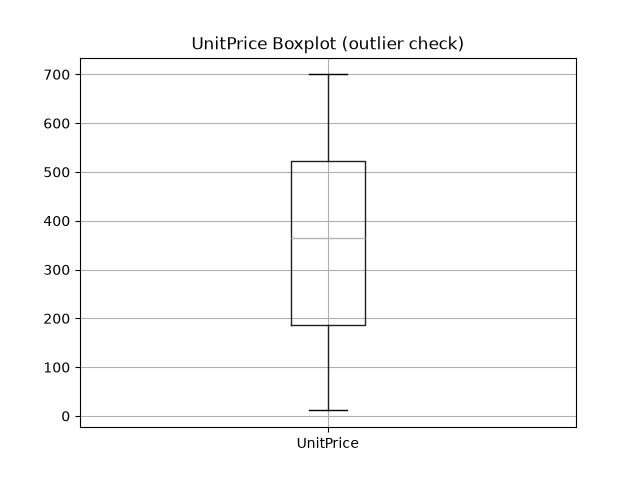
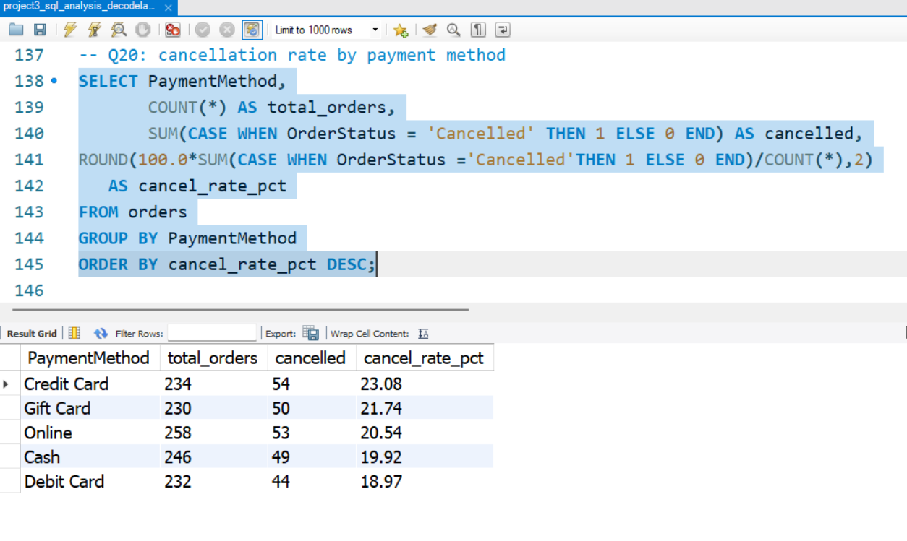

# DecodeLabs Data Analytics Bootcamp: Projects 1 to 4

A four-project portfolio that follows the full analytics workflow on one e-commerce orders dataset: **clean, explore, query, visualize.**

| # | Project | Tools | Folder |
|---|---|---|---|
| 1 | Data Cleaning & Preparation | Python, VS Code | [`dclab_project 1`](./dclab_project%201) |
| 2 | Exploratory Data Analysis (EDA) | Python | [`dclab_project 2`](./dclab_project%202) |
| 3 | SQL Data Analysis | MySQL Workbench 8.0 CE | [`dclab_project 3`](./dclab_project%203) |
| 4 | Data Visualization & Storytelling | Power BI, Power Query, DAX | [`dclab_project 4`](./dclab_project%204) |

*DecodeLabs Industrial Training Kit, Batch 2026*

---

## Dataset

E-commerce orders dataset provided by DecodeLabs.

| Column | Description |
|---|---|
| OrderID, CustomerID | Order and customer identifiers |
| Date | Order date (stored as an Excel serial number in the raw file) |
| Product, Quantity, UnitPrice, TotalPrice | What was ordered and its value |
| ShippingAddress, TrackingNumber | Fulfilment details |
| PaymentMethod | Cash, Credit Card, Debit Card, Gift Card, Online |
| OrderStatus | Shipped, Delivered, Pending, Returned, Cancelled |
| ItemsInCart, CouponCode, ReferralSource | Cart and marketing attributes |

Known data quality issues: missing values in `CouponCode` and `ReferralSource`, and dates stored as Excel serial numbers.

---

## Project 1: Data Cleaning & Preparation

**Goal:** Turn the raw orders file into an analysis-ready dataset.

**What I did**
- Loaded the raw file `raw/Dataset for Data Analytics.xlsx` into Python in VS Code
- Audited the data for quality issues, including missing values in `CouponCode` and `ReferralSource` and dates stored as Excel serial numbers
- Applied the cleaning rules in `dcl_p1.py`
- Recorded every change made to the data in `change_log.xlsx`, so the cleaning is fully traceable
- Exported the final result as `cleaned_dataset.xlsx`

**Files**

| File | Purpose |
|---|---|
| `raw/Dataset for Data Analytics.xlsx` | Original raw dataset (kept untouched) |
| `dcl_p1.py` | Cleaning script |
| `change_log.xlsx` | Log of changes applied to the data |
| `cleaned_dataset.xlsx` | Analysis-ready output |

**Tools:** Python, VS Code

---

## Project 2: Exploratory Data Analysis

**Goal:** Understand the structure, quality and patterns in the orders data before deeper analysis.

**What I did**
- Checked the dataset for duplicates and missing values
- Explored sales by product, the distribution of order values (`TotalPrice`), and the spread and outliers of `UnitPrice`
- Wrote the full analysis in `eda.py/dcl_p2.py`

**Findings**
- No duplicate `OrderID` values in the dataset
- Missing values are concentrated in `CouponCode` and `ReferralSource`

**Charts**

| Sales by product | Order value distribution | Unit price outliers |
|---|---|---|
|  |  |  |

**Files:** `eda.py/dcl_p2.py`, `Dataset for Da2.xlsx`, `sales_by_product.png`, `totalprice_distribution.png`, `unitprice_boxplot.png`

**Tools:** Python

---

## Project 3: SQL Data Analysis

**Goal:** Extract business insights from the orders data using SQL.

**Concepts used:** `SELECT`, `WHERE`, `GROUP BY`, `ORDER BY`, and aggregations (`COUNT`, `SUM`, `AVG`)

**Analyses in `data_analysis.sql`**

| Query | Analysis | Output |
|---|---|---|
| Q7 | Headline KPIs | `Q7_headline_kpis.png` |
| Q8 | Net revenue | `Q8_net_revenue.png` |
| Q10 | Revenue by product | `Q10_revenue_by_product.png` |
| Q11 | Orders by status | `Q11_orders_by_status.png` |
| Q12 | Average order value by payment method | `Q12_avg_order_value_by_payment.png` |
| Q13 | Revenue by referral source | `Q13_revenue_by_referral_source.png` |
| Q18 | Percentage of revenue by product | `Q18_pct_revenue_by_product.png` |
| Q19 | Percentage of orders by status | `Q19_pct_orders_by_status.png` |
| Q20 | Cancellation rate by payment method | `Q20_cancellation_rate_by_payment.png` |
| Q21 | Return rate by product | `Q21_return_rate_by_product.png` |
| Q22 | Top 5 customers by spend | `Q22_top5_customers_by_spend.png` |

**Findings**
- Around 21% of orders are cancelled and around 21% are returned, so roughly 4 in 10 orders do not complete as sold
- Cancellation rates are similar across payment methods, ranging from 19% (Debit Card) to 23% (Credit Card)

**Sample output**



**Tools:** MySQL Workbench 8.0 CE

---

## Project 4: Data Visualization & Storytelling


**Business question:** Which payment methods are associated with the lowest order return rates?

**Key insight:** **Online payments show a 15% return rate, 6 to 8 points lower than every other payment method.**

| Payment Method | Returned Rate |
|---|---|
| Online | **15%** |
| Credit Card | 21% |
| Debit Card | 22% |
| Gift Card | 23% |
| Cash | 23% |

**Recommendation:** Test incentives that steer customers toward online checkout, then monitor whether overall return rates fall.

**Process**
- **Power Query:** converted the Excel serial dates to a Date type, replaced null coupon codes with "None", and verified numeric types
- **DAX measures:** Total Revenue, Avg Order Value, Order Count, Cancelled Rate, Returned Rate, Online Return Rate
- **Design:** action title, one accent color on the key bar, no gridlines, direct data labels, a Situation, Complication, Resolution narrative, and the KPI card placed top-left

```DAX
Returned Rate = DIVIDE(CALCULATE(COUNTROWS(Sheet1), Sheet1[OrderStatus] = "Returned"), [Order Count])
Online Return Rate = CALCULATE([Returned Rate], Sheet1[PaymentMethod] = "Online")
```

**Limitations**
- Rates include Pending and Shipped orders that have not yet had time to be returned
- This shows an association, not proven causation
- The gaps are modest and no significance test was run

**Files:** `dcl_pbi.pbix`, `Dashboard.png`, `Dataset for Data Analytics (1).xlsx`

**Tools:** Power BI, Power Query, DAX

---

## Skills Demonstrated

| Area | Skills |
|---|---|
| Data preparation | Cleaning, type conversion, handling missing values, change logging |
| Analysis | EDA, distributions, outlier checks, aggregation |
| SQL | Filtering, grouping, sorting, aggregate functions, rate calculations |
| BI & visualization | Power Query, DAX, chart selection, data storytelling |

---

## Repository Structure

```
dclab project
├── dclab_project 1
│   ├── raw
│   │   └── Dataset for Data Analytics.xlsx
│   ├── change_log.xlsx
│   ├── cleaned_dataset.xlsx
│   ├── dcl_p1.py
│   └── README.md
├── dclab_project 2
│   ├── eda.py
│   │   └── dcl_p2.py
│   ├── Dataset for Da2.xlsx
│   ├── sales_by_product.png
│   ├── totalprice_distribution.png
│   ├── unitprice_boxplot.png
│   └── README.md
├── dclab_project 3
│   ├── data_analysis.sql
│   ├── Q7_headline_kpis.png ... Q22_top5_customers_by_spend.png
│   └── README.md
└── dclab_project 4
    ├── Dashboard.png
    ├── Dataset for Data Analytics (1).xlsx
    ├── dcl_pbi.pbix
    └── README.md
```

---

## Author

**Riya Patra**
B.Tech Computer Science, MAKAUT
[LinkedIn](https://www.linkedin.com/in/riya-patra-95310b332) · [GitHub](https://github.com/riya-patra)